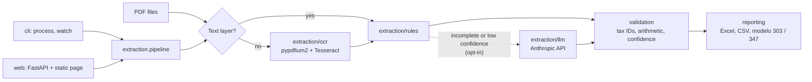

# invoice-pdf-to-excel

Extracts the key data from Spanish PDF invoices, validates it, and consolidates it into an Excel report an accountant can work from: invoice detail, VAT breakdown, a quarterly input-VAT summary for modelo 303, and annual supplier totals for the modelo 347 threshold.

It reads text PDFs directly, runs OCR on scanned ones, and can optionally ask an LLM for a second opinion when the built-in rules are not enough. Everything runs locally unless you explicitly enable the LLM extractor.

The tool targets **Spanish invoices**: Spanish labels (*Base imponible*, *Cuota IVA*, *Total factura*, *Nº Factura*), NIF/CIF/NIE tax IDs, IVA, IRPF withholding, recargo de equivalencia, `1.234,56 €` amounts and `dd/mm/yyyy` dates. The sample PDFs are in that format too; all companies, people and tax IDs in them are fictitious.

## Features

- **Extraction** of issuer, tax ID, invoice number, date, one tax line per VAT rate (base, rate, quota, recargo de equivalencia), IRPF withholding and total.
- **OCR** for image-only PDFs (pypdfium2 + Tesseract).
- **Validation**: NIF/CIF/NIE check characters; each VAT line against its base and rate; `base + VAT + surcharge - IRPF = total`; duplicate invoices (same issuer and number).
- **Confidence scores** per field and per invoice. Low-confidence cells are highlighted in the Excel report.
- **Optional LLM extractor** (Anthropic API, structured output through tool use). Off by default.
- **Reports**: Excel (invoices, tax lines, VAT 303, suppliers 347, issues) and CSV.
- **Interfaces**: batch CLI, watch-folder mode, and a single-page web UI.

## Architecture



| Package | Responsibility |
|---|---|
| `extraction/rules.py` | Regex-based extractor for common layouts; produces tax lines and field confidence |
| `extraction/ocr.py` | Renders pages and reads them with Tesseract; language detection and fallback |
| `extraction/llm.py` | Optional extractor using a forced tool call; accepts any client with `messages.create` |
| `extraction/pipeline.py` | Chooses text layer or OCR, rules or LLM, then validates and scores |
| `validation/` | Tax ID checks, invoice arithmetic, duplicates, confidence adjustment |
| `reporting/` | Excel and CSV writers, 303 and 347 aggregations |
| `watch.py` | Watch-folder loop and the running report |
| `web/` | FastAPI app and the static single page |
| `cli.py` | Typer commands |
| `config.py`, `logging_config.py` | Settings from the environment, structured logging |

## Quickstart

Requires Python 3.12 and [uv](https://docs.astral.sh/uv/).

### Local

```bash
uv sync --extra ocr --extra web        # add --extra llm for the LLM extractor
uv run invoice-to-excel process test_data/invoices --out reports/invoices_report.xlsx
```

This writes `reports/invoices_report.xlsx` and `reports/invoices_report.csv`.

OCR needs the Tesseract binary and, for good accuracy on Spanish text, its Spanish language data:

```bash
brew install tesseract tesseract-lang           # macOS
sudo apt install tesseract-ocr tesseract-ocr-spa  # Debian / Ubuntu
```

If `spa` is not installed, the tool falls back to `eng` and logs a warning. Digits, tax IDs and most labels still read correctly, but accented characters and names suffer.

Without uv: `pip install -e '.[ocr,web]'` and use the `invoice-to-excel` command.

### Docker

```bash
docker compose up --build
# open http://127.0.0.1:8000
```

The image is multi-stage, runs as a non-root user and includes Tesseract with Spanish data. The compose file publishes the port on the loopback interface only. Put a reverse proxy with authentication in front of it before exposing it to a network.

### Web UI

```bash
uv run invoice-to-excel serve        # http://127.0.0.1:8000
```

Drag and drop PDFs onto the page. Each file is processed in a temporary directory that is deleted when the request ends, and a progress bar tracks the batch. The page shows a preview table (red rows need review, amber cells have low confidence), the modelo 303 and 347 summaries, and buttons to download Excel or CSV. The server stores nothing: exports are rebuilt from the results the browser sends back. Uploads are limited by `INVOICE_WEB_MAX_UPLOAD_MB` and `INVOICE_WEB_MAX_FILES`.

### Python

```python
from pathlib import Path

from invoice_to_excel.config import Settings
from invoice_to_excel.extraction import build_pipeline
from invoice_to_excel.reporting import write_excel

result = build_pipeline(Settings()).process_folder(Path("invoices"))
write_excel(result, Path("report.xlsx"))
```

## CLI reference

```
invoice-to-excel [--verbose] [--log-format text|json] [--version] COMMAND
```

| Command | Purpose |
|---|---|
| `process FOLDER` | Process a folder of PDFs into an Excel report and CSV |
| `watch FOLDER` | Process PDFs as they appear; keep a running report |
| `serve` | Run the web UI |

Options of `process` and `watch`:

| Option | Default | Description |
|---|---|---|
| `--out PATH` | `reports/invoices_report.xlsx` | Output workbook; the CSV is written next to it |
| `--no-csv` | off | Skip the CSV |
| `--csv-locale en\|es` | `en` | `en`: comma separator, dot decimal, ISO dates. `es`: semicolon, decimal comma, `dd/mm/yyyy` |
| `--extractor rules\|llm\|auto` | `rules` | See [Privacy](#privacy) before using `llm` or `auto` |
| `--ocr / --no-ocr` | `--ocr` | OCR for PDFs without a text layer |
| `--recursive` (`process`) | off | Include subfolders |
| `--existing / --no-existing` (`watch`) | `--existing` | Also process PDFs already in the folder at startup |

`serve` takes `--host` and `--port`. Exit codes of `process`: `0` success, `1` no PDFs found, `2` usage or configuration error.

### Watch mode

```bash
uv run invoice-to-excel watch ~/invoices/inbox --out ~/invoices/report.xlsx
```

New PDFs are processed once their size has been stable for `INVOICE_WATCH_SETTLE_SECONDS`. Each result is appended to the report (rebuilt in full, so duplicates are detected across runs). Successfully read invoices are moved to `inbox/processed/`; files that could not be read as invoices go to `inbox/failed/`. The report keeps a JSON-lines ledger next to the workbook (`report.jsonl`), which is how it survives restarts. Stop with Ctrl-C or SIGTERM.

## Reports

| Sheet | Content |
|---|---|
| `Invoices` | One row per invoice: tax ID, number, date, net, VAT rates, VAT, surcharge, IRPF, total, confidence, extraction method, status and notes |
| `Tax lines` | One row per invoice and VAT rate: base, rate, quota, surcharge |
| `VAT 303` | Input VAT by quarter and rate with quarter subtotals, for preparing modelo 303 |
| `Suppliers 347` | Annual operations per supplier (VAT included, IRPF not deducted); suppliers over 3,005.06 EUR are flagged for modelo 347 |
| `Issues` | Files that could not be read, with the reason |

Duplicates are excluded from the 303 and 347 aggregates. Invoices that need review are included and counted in a `To review` column, so you can see how much of a figure rests on unverified data. These sheets support preparing the returns; they are not a substitute for the filing itself.

Sample, from the fictitious invoices in [`test_data/invoices`](test_data/invoices) (full output in [`reports/`](reports)):

| Supplier | Tax ID | No. | Date | Net | VAT % | VAT | Surcharge | IRPF | Total | Conf. | Extraction | Status |
|---|---|---|---|---:|---|---:|---:|---:|---:|---:|---|---|
| Suministros Ficticios, S.L. | B87654323 | 2026-001 | 2026-01-15 | 252.60 | 21% | 53.05 | | | 305.65 | 0.91 | rules | OK |
| Reformas Escaneadas, S.L. | B55443329 | R-2026-05 | 2026-03-02 | 3440.00 | 21% | 722.40 | | | 4162.40 | 0.83 | rules + OCR | OK |
| Marta Ficticia Ruiz | 12345678Z | F-2026/003 | 2026-03-15 | 1650.00 | 21% | 346.50 | | 247.50 | 1749.00 | 0.85 | rules | OK |
| Suministros Ficticios, S.L. | B87654323 | 2026-031 | 2026-04-09 | 396.00 | 21% | 83.16 | | | 489.16 | 0.59 | rules | Review: total does not add up (expected 479.16) |
| Ferretería Ficticia, S.L. | B22334452 | F-2026-0118 | 2026-07-21 | 698.00 | 21% + 10% | 100.38 | | | 798.38 | 0.91 | rules | OK |
| Distribuciones Imaginarias, S.A. | A31415920 | B-5521 | 2026-08-17 | 722.00 | 21% + 10% | 104.10 | 21.13 | | 847.23 | 0.91 | rules | OK |

`VAT 303` sheet for the same data:

| Quarter | VAT % | Invoices | Net | VAT | Surcharge |
|---|---|---:|---:|---:|---:|
| 2026-T1 | 21% | 5 | 6,372.60 | 1,338.25 | 0.00 |
| 2026-T2 | 21% | 5 | 7,416.50 | 1,557.47 | 0.00 |
| 2026-T2 | 10% | 1 | 1,285.90 | 128.59 | 0.00 |
| 2026-T2 | 4% | 1 | 400.20 | 16.01 | 0.00 |
| 2026-T3 | 21% | 4 | 1,252.00 | 262.92 | 32.86 |
| 2026-T3 | 10% | 3 | 1,032.00 | 103.20 | 6.05 |
| 2026-T3 | 4% | 1 | 747.00 | 29.88 | 0.00 |
| 2026-T4 | 21% | 1 | 126.00 | 26.46 | 0.00 |
| 2026-T4 | 10% | 1 | 980.00 | 98.00 | 0.00 |

## Confidence

Each extractor reports how it found every field (a labelled value scores higher than a guess from position or a derived figure). Validation then adjusts the scores: a tax ID with a correct check character and amounts that reconcile raise confidence, a failed check lowers it, and missing fields score zero. OCR output is scaled down by Tesseract's mean word confidence. The invoice score is the mean of the required fields (supplier, tax ID, number, date, net, total), multiplied by 0.8 when validation found problems.

Fields below `INVOICE_CONFIDENCE_THRESHOLD` (default 0.7) get an amber cell and a comment in the Excel report. In `auto` mode the same threshold decides whether the LLM is consulted.

## Configuration

Settings are read from `INVOICE_*` environment variables and an optional `.env` file (see [`.env.example`](.env.example)). Command-line options override them. No secrets are stored in the repository.

| Variable | Default | Description |
|---|---|---|
| `INVOICE_LOG_LEVEL` / `INVOICE_LOG_FORMAT` | `INFO` / `text` | Log level; `text` (key=value) or `json` (one object per line) on stderr |
| `INVOICE_EXTRACTOR` | `rules` | `rules`, `llm` or `auto` |
| `INVOICE_CONFIDENCE_THRESHOLD` | `0.7` | Highlighting threshold and `auto` fallback trigger |
| `INVOICE_CSV_LOCALE` | `en` | `en` or `es` |
| `INVOICE_OCR_ENABLED` | `true` | Run OCR on PDFs without a text layer |
| `INVOICE_OCR_LANGUAGE` | `spa` | Tesseract language; `spa+eng` style combinations work; falls back to `eng` |
| `INVOICE_OCR_DPI` | `300` | Rendering resolution for OCR |
| `INVOICE_TESSERACT_CMD` | | Path to the Tesseract binary if not on `PATH` |
| `INVOICE_LLM_ENABLED` | `false` | Opt-in switch for any use of the LLM extractor |
| `INVOICE_LLM_MODEL` | `claude-sonnet-5-5` | Model used by the LLM extractor |
| `INVOICE_LLM_MAX_TOKENS` | `2048` | Output limit per invoice |
| `ANTHROPIC_API_KEY` | | API key for the LLM extractor |
| `INVOICE_WEB_HOST` / `INVOICE_WEB_PORT` | `127.0.0.1` / `8000` | Web UI bind address |
| `INVOICE_WEB_MAX_UPLOAD_MB` / `INVOICE_WEB_MAX_FILES` | `10` / `50` | Upload limits |
| `INVOICE_WATCH_SETTLE_SECONDS` | `1.0` | Stable-size wait before a watched file is processed |

## Privacy

By default nothing leaves your machine: rule-based extraction and OCR run locally and the tool makes no network calls.

The **LLM extractor sends the full text of each invoice to the Anthropic API**. That text contains your suppliers' and customers' names, tax IDs and amounts. It is therefore opt-in twice over:

1. `INVOICE_LLM_ENABLED=true` must be set. Without it, `--extractor llm` and `--extractor auto` are refused with an error, and the web server refuses to start with such a configuration.
2. The extractor must be selected (`--extractor llm|auto` or `INVOICE_EXTRACTOR`), and `ANTHROPIC_API_KEY` must be set.

When enabled, a warning is logged at startup, the web UI shows a notice, and the `/api/config` endpoint reports `sends_data_to_third_party: true`. Only extracted text is sent, never the PDF file itself. Check your data-processing obligations (GDPR, client confidentiality) and Anthropic's current terms before enabling it. Results from the LLM pass through exactly the same validation as rule-based ones, and its self-reported confidence is capped.

The web UI keeps uploads in a temporary directory for the duration of one request and writes nothing else to disk. It has no authentication or TLS; do not expose it to untrusted networks without a reverse proxy that provides both.

## Supported invoice formats

The rules cover, among others:

- Labels for the issuer's ID (`NIF`, `CIF`, `C.I.F.`, `DNI`, `NIE`), invoice number (`Nº Factura`, `Fra. nº`, `Número de factura`, `Factura nº`) and amounts (`Base imponible`, `Base`, `Subtotal`, `IVA 21%`, `Cuota IVA`, `Total factura`, `Total a pagar`, `TOTAL`).
- Dates as `15/03/2026`, `15-03-2026`, `15.03.2026`, `2026-03-15` and `15 de marzo de 2026`; due dates are ignored.
- The customer block (`Cliente`, `Facturar a`, `Destinatario`) is skipped so the customer's tax ID is never taken as the issuer's.
- One base and quota per rate on labelled lines (`Base imponible 21%` / `IVA 21%`).
- A breakdown table with one row per rate, including `% R.E.` / `Cuota R.E.` columns for recargo de equivalencia.
- IRPF withholding, with or without a stated percentage.
- VAT-exempt invoices (0%); the rate is inferred from base and quota when only those are printed.

### Adding rules

Layouts vary by supplier, so expect to tune the rules against a batch of real invoices.

1. **A new label or format.** Edit the patterns at the top of [`extraction/rules.py`](src/invoice_to_excel/extraction/rules.py) (`_NET_RE`, `_TOTAL_RE`, `_NUMBER_RE`, `_TABLE_COLUMN`...). Add a template to [`scripts/generate_test_data.py`](scripts/generate_test_data.py) that reproduces the layout with fictitious data, and an assertion in `tests/test_rules.py`.
2. **One supplier with an unusual layout.** Subclass the extractor and plug it into the pipeline:

   ```python
   from invoice_to_excel.extraction import Pipeline, RuleBasedExtractor
   from invoice_to_excel.models import Invoice


   class AcmeExtractor(RuleBasedExtractor):
       def extract(self, text: str, filename: str) -> Invoice:
           invoice = super().extract(text, filename)
           if "ACME" in text:
               ...  # adjust or fill fields, set invoice.confidence["number"] = 0.9
           return invoice


   pipeline = Pipeline(rules=AcmeExtractor())
   ```

   Any class implementing `Extractor.extract(text, filename) -> Invoice` works. Validation and scoring always run afterwards.

## Limitations

- Rule-based extraction is heuristic. Unusual layouts, several invoices in one PDF, or credit notes (*facturas rectificativas*) may be misread; the `Review` status and confidence scores exist to catch that, not to guarantee correctness.
- Euro amounts only. IGIC (Canary Islands), reverse-charge and intra-EU invoices are not modelled.
- Only received invoices are considered: the 303 sheet is input VAT, and the 347 sheet is purchases per supplier.
- OCR quality depends on scan quality. Fallback to English data (when `spa` is missing) reduces accuracy on names and accents. Handwriting is not supported.
- Duplicate detection matches on issuer tax ID and invoice number only.
- The web UI serialises PDF processing (the PDF and OCR libraries are not safe to run concurrently), so it suits a handful of users, not a shared service.
- The LLM extractor only receives extracted text, so it cannot recover from a failed OCR.

## Development

```bash
uv sync --all-extras
uv run ruff check . && uv run ruff format --check .
uv run mypy
uv run pytest                                   # coverage gate: 85%
uv run python scripts/generate_test_data.py     # regenerate test_data/invoices
```

Tests need no network: the LLM client is a fake, the web app runs through `TestClient`, and OCR tests use the installed Tesseract (they skip when it is missing). See [CONTRIBUTING.md](CONTRIBUTING.md).

## Layout

```
src/invoice_to_excel/
    extraction/   rules.py, ocr.py, llm.py, pipeline.py
    validation/   tax_id.py, invoice.py, confidence.py
    reporting/    excel.py, csv_export.py, summaries.py, tables.py
    web/          app.py, static/
    cli.py  config.py  logging_config.py  models.py  normalizers.py  watch.py
scripts/          generate_test_data.py
tests/
test_data/invoices/   fictitious Spanish-format PDFs (including one image-only scan)
reports/              Excel and CSV generated from the test data
```

## License

[MIT](LICENSE)
